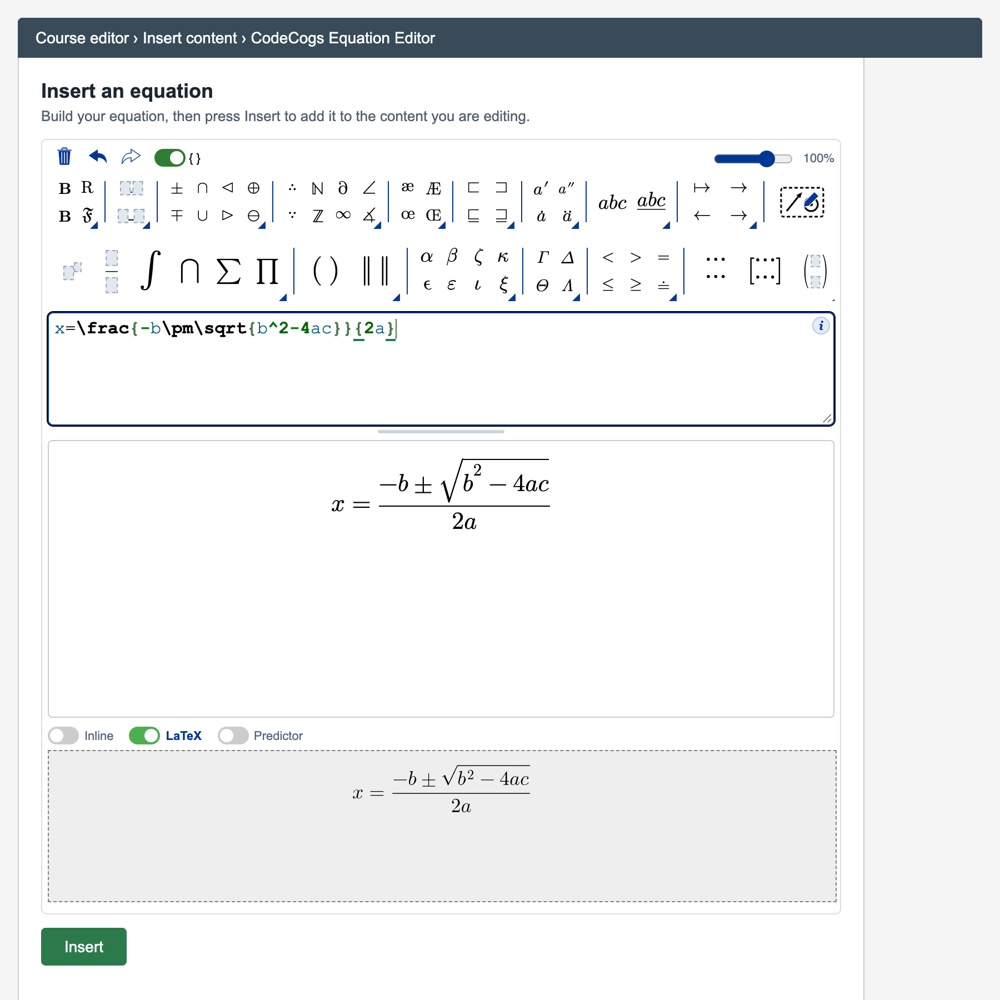

# fxEditor for learning platforms (LTI 1.3)

fxEditor as a single **LTI 1.3 Advantage** tool. Learning platforms share a standard for plugging
in tools, LTI 1.3: once this tool is registered with a platform, it appears in the platform's
content picker or editor (*Insert from App*, *External Tool*, Canvas's Rich Content Editor button
and the like). An instructor opens it, writes the equation in fxEditor - CodeCogs' equation editor,
with a toolbar of symbols and structures, a LaTeX view and a rendered maths view - presses
**Insert**, and the equation is placed in the page they were editing as an image, with its LaTeX
as the alt text.

One deployment serves every platform it is registered with: Canvas, Blackboard, Brightspace (D2L),
Schoology, Moodle, or any other LTI 1.3 platform. CodeCogs runs it at **https://lti.codecogs.com**;
you can also run it yourself from this repository.



*What an instructor sees once the platform opens the tool (here outside an LMS): build the
equation, then press Insert.*

- Documentation and live example: https://fxplugins.codecogs.com/docs/lti.html
- Customise and download: https://fxplugins.codecogs.com/docs/lti.html#customise
- All the fxEditor plugins: https://fxplugins.codecogs.com
- fxEditor: https://fxeditor.codecogs.com

The tool asks platforms for no personal data - no names, email addresses, grades or class lists -
and keeps none; see *Personal data* below.

## Using the hosted tool (LMS administrators)

- **Moodle, Canvas, Brightspace** - register it with LTI Dynamic Registration: paste
  `https://lti.codecogs.com/register` into the platform (Moodle: *Site administration > Plugins >
  Activity modules > External tool > Manage tools*; Canvas: *Admin > Developer Keys > + LTI
  Registration*; Brightspace: *Manage Extensibility > LTI Advantage > Register Tool*). The platform
  and the tool exchange everything else themselves.
- **Blackboard, Schoology, or a platform without Dynamic Registration** - register an LTI 1.3 tool
  by hand with login URL `https://lti.codecogs.com/login`, launch/redirect URL
  `https://lti.codecogs.com/launch` and keyset URL `https://lti.codecogs.com/keys`, and
  [contact us](https://fxeditor.codecogs.com/contact) with the client ID and endpoints your
  platform issues, so we can add them on our side.

## Licence key

Equations are drawn by fxTeX Pro, which is licensed. An institution using the hosted tool needs an
fxEditor licence, recognised in either of two ways:

- **by key** - the platform administrator adds the custom parameter
  `fxeditor_licence=fx_pk_...` to the tool's settings in the LMS, and every launch carries it;
- **by address** - the platform's own address (for example `yourschool.instructure.com`) is added
  as a domain on the licence.

Get the licence from https://fxeditor.codecogs.com/purchase.

## Installing from git (running it yourself)

It is a Node.js server (Node 22), and needs a MongoDB database and a public HTTPS address -
platforms show LTI tools in a frame, which must be secure.

```bash
git clone https://github.com/willzyba/lti.git
cd lti
npm install
cp .env.example .env                        # then set MONGO_URL, TOOL_URL and EQNEDITOR_LICENCE
cp platforms.example.json platforms.json    # only for platforms registered by hand
npm start
```

`EQNEDITOR_LICENCE` is the fxTeX Pro licence for *your* tool's own address (every page the tool
shows is on it, whichever institution launched it) - or set `EQNEDITOR_LICENCE_FILE` to a file
holding it. For production, `Dockerfile` builds the image and `docker-swarm/docker-fxlti.yml` runs
two replicas with MongoDB, the licence coming from a Docker secret:

```bash
printf %s 'fx_pk_...' | docker secret create fxlti_licence -
docker stack deploy -c docker-swarm/docker-fxlti.yml fxlti
```

Every setting is in *Configuration* below.

## Licence

Copyright (c) 2026 CodeCogs, Zyba Ltd.

The tool's code is released under the MIT licence - see
[`LICENSE`](https://github.com/willzyba/lti/blob/main/LICENSE). fxTeX Pro, which draws the
equations, is a licensed CodeCogs service.

---

## For developers

Built on [ltijs](https://github.com/Cvmcosta/ltijs) v7. **v7 is a full rewrite** with a different
API from v5, which is what most tutorials (and most of what anyone, human or LLM, already knows
about ltijs) describe. Every ltijs call in `src/` was checked against the installed package's own
`.d.ts` files - do the same before changing one.

## Verified against

**Moodle 4.5 LTS** (4.5.15+, November 2026, in Docker - see "Testing locally"), end to end:

- Dynamic Registration from Moodle's *Manage tools* - Moodle recorded the tool with names and
  email never sent and no grade or roster services.
- A Deep Linking launch from an External tool activity's *Select content*: the editor opens in
  Moodle's dialog, Insert returns a signed Deep Linking response, Moodle verifies it against
  `/keys` and creates the activity.
- The activity itself: a Resource Link launch carrying the equation in its custom parameters,
  shown as the image.
- The stored launch token: no name, email, `ext` or course title in it.
- The deployment record: launches and inserts counted by month, licence looked up.

**Not yet tried against** Canvas, Blackboard, Brightspace or Schoology - no sandbox for any of
them yet. Canvas's registration takes its own extras (see `src/registration.js`), unverified.

## How it fits together

```
src/server.js         Provider, launches, /config, /insert, /logo.svg, /health.
src/registration.js   Dynamic Registration at /register - what the tool asks the LMS for.
src/deployments.js    One record per LMS deployment: usage by month, and its licence.
src/content.js        The one Deep Linking content item an equation becomes.
src/platforms.js      Manual registrations, from platforms.json (or PLATFORMS_JSON).
views/launch.html     The editor page - the same EqEditor UI every other adapter embeds.
```

### Getting onto an LMS

- **Dynamic Registration** (Moodle, Canvas, Brightspace): the LMS administrator pastes
  `https://lti.codecogs.com/register` into the LMS - Moodle's *Site administration > Plugins >
  External tool > Manage tools*, Canvas's *Developer Keys > + LTI Registration*, Brightspace's
  *Manage Extensibility > LTI Advantage > Register Tool (Dynamic)*. The two exchange everything
  else themselves. The tool asks for:
  - no services (no grades, no rosters);
  - claims `iss` and `sub` only - no names or email. Moodle reads exactly this list to decide
    whether to send names and email;
  - on Canvas, also `privacy_level: anonymous` and the Rich Content Editor button
    (`editor_button`).
  Registrations are active at once; whether an institution may *use* the tool is a licensing
  question, answered at launch.
- **Manual registration** (Blackboard, Schoology, or any LMS without Dynamic Registration): the
  LMS's values go into `platforms.json` - see `platforms.example.json` - and the tool's into the
  LMS: login `https://lti.codecogs.com/login`, launch/redirect `https://lti.codecogs.com/launch`,
  keys `https://lti.codecogs.com/keys`.

### A launch

1. An instructor opens the tool from a content picker or an editor button - a **Deep Linking**
   launch - or from a link - a **Resource Link** launch.
2. The page loads `fxeditor.api.min.js` and `fxeditor.css` from fxtex.codecogs.com, like every
   other adapter.
3. **Insert** posts a real HTML form to `/insert` (not `fetch()` - a Deep Linking response is
   itself an auto-submitting page, which only runs if the browser renders it as one).
4. `/insert` checks the image is from the configured renderer, then answers with **one** content
   item of the best kind the placement accepts (`src/content.js`): `html` (an `` with the
   LaTeX as alt text, for editor buttons), else `image`, else `link`, else `ltiResourceLink` - a
   link back to this tool that shows the equation, which is all Moodle's *Select content* takes.
   One item, because a platform accepting several would otherwise insert the equation several
   times.

### Licences and usage

Every page here is on lti.codecogs.com, whichever institution opened it, so fxTeX Pro on the page
runs under CodeCogs' own licence for that address (`EQNEDITOR_LICENCE`). What identifies an
institution is its LMS registration - issuer, client id, deployment id - and
`src/deployments.js` keeps one record per deployment (collection `fxdeployments`): its LMS address,
launches and inserts by month, and its licence, checked against fxtex's `/diagnostics.json` (the
same registry as every other licence) at most hourly. An institution is licensed by either:

- **key**: its LMS administrator sets the tool's custom parameter `fxeditor_licence=fx_pk_...`;
- **address**: its LMS's own address (from the launch's return URLs - not the issuer, which
  Canvas and Blackboard share between all customers) is a registered domain on its licence.

`LICENCE_MODE=log` (the default) only records; `LICENCE_MODE=enforce` shows an unlicensed
deployment how to get licensed instead of the editor.

### Personal data

None is needed, and none is kept. Registration asks for none (above). Whatever a launch still
carries is stripped before ltijs stores the launch token (`server.js`): names, email, picture,
`lis`, vendor `ext`, and the course's title and code. What remains - an opaque user id, roles,
the course's opaque id, the platform's identifiers - is deleted after 24 hours (ltijs' TTL index on
`idTokens`). Deployment records hold no user or course data. This is what the Privacy Policy and
Student Data Privacy pages on fxeditor.codecogs.com describe; keep them in step.

## Configuration

| Env var | Default | Meaning |
|---|---|---|
| `MONGO_URL` | *(required)* | ltijs' store and the deployment records. |
| `TOOL_URL` | `http://localhost:$PORT` | This tool's public address, as LMSs reach it. |
| `PORT` | `3000` | |
| `LICENCE_MODE` | `log` | `log` or `enforce` - see above. |
| `FXTEX_ORIGIN` | `https://fxtex.codecogs.com` | Where licences are checked. |
| `EQNEDITOR_LICENCE` | *(empty)* | fxTeX Pro licence for the tool's own address. |
| `EQNEDITOR_LICENCE_FILE` | *(unset)* | A file holding that licence instead - a Docker secret in production (`docker-swarm/docker-fxlti.yml`), so the key is never committed. |
| `EQNEDITOR_SERVER` | `https://fxtex.codecogs.com` | Where the editor is loaded from. |
| `EQNEDITOR_RENDER_URL` | `https://fxtex.codecogs.com` | Where equation images are rendered - and the only host `/insert` accepts images from. |
| `EQNEDITOR_SHOW_LATEX` | `false` | Show the LaTeX pane by default. |
| `EQNEDITOR_DESIGN` | *(none)* | The `design` option, as JSON. |
| `PLATFORMS_FILE` / `PLATFORMS_JSON` | `./platforms.json` | Manual registrations. |
| `DEBUG` | *(unset)* | Any value: ltijs' debug lines too. Warnings and errors are always logged. |

## Testing locally

Against the Moodle 4.5 test site in `/Users/will/Data/Vultr/moodle-dev` (see
moodle-tiny_eqneditor's README.md):

1. MongoDB: `docker run -d --name fxlti-mongo -p 127.0.0.1:27017:27017 mongo:7`.
2. The tool: the `fxeditor-lti` entry in fxPlugins' `.claude/launch.json` (this repository is its `lti/` submodule) (`TOOL_URL=http://localhost:3000`).
3. Moodle must reach the tool at the *same* address the browser uses. Inside the Moodle container
   `localhost` is the container, so a forwarder shares its network and passes `localhost:3000` on
   to the Mac:
   `docker run -d --name moodle405-ltifwd --network container:moodle405-webserver-1 alpine/socat TCP-LISTEN:3000,fork,reuseaddr,bind=127.0.0.1 TCP:192.168.65.254:3000`.
   (Two things that do not work: `*.localhost` names - curl, and so Moodle, always resolves them
   to the container itself; and the Mac's LAN address - Chrome's Local Network Access blocks the
   tool's page from redirecting back to Moodle on `localhost`.)
4. Register with `http://localhost:3000/register` in Moodle's *Manage tools*, activate it, then
   add an External tool activity and *Select content*.
